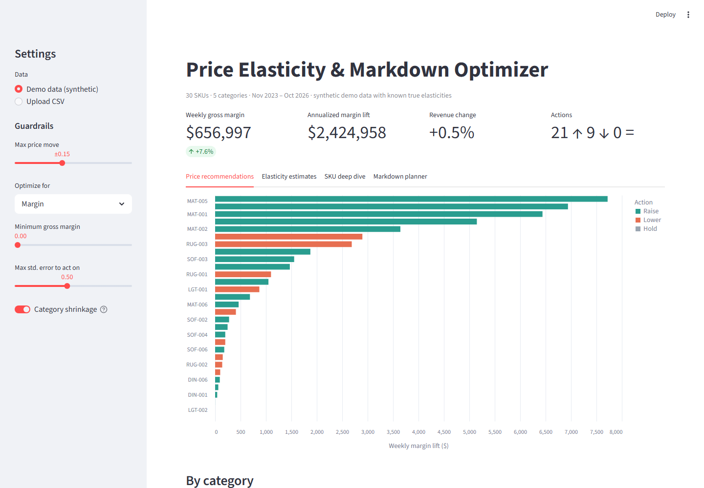
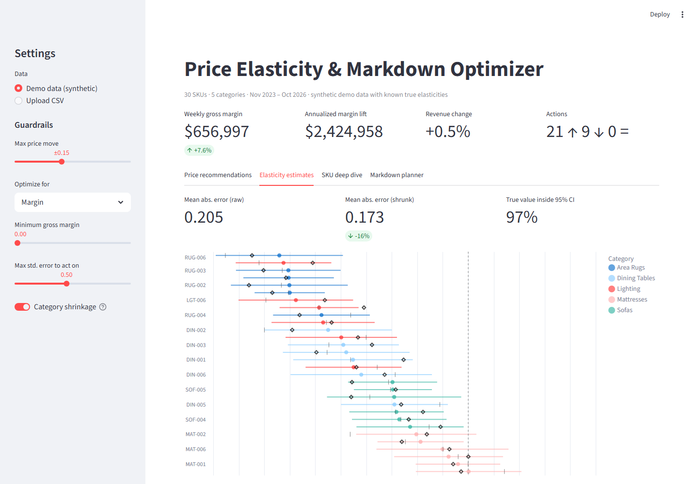
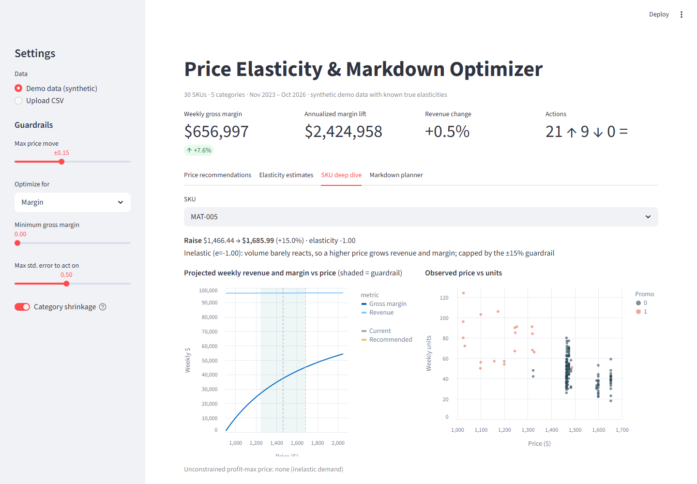
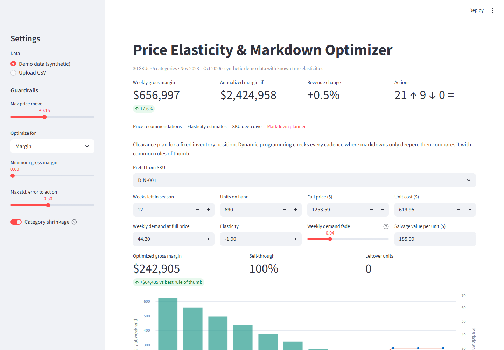

# Price Elasticity & Markdown Optimizer

Estimates how sensitive each SKU's demand is to price, recommends the profit-maximizing price within business guardrails, and plans clearance markdowns that beat standard rule-of-thumb cadences. It comes with a CLI and an interactive Streamlit dashboard.

**The problem:** most retail pricing decisions are made on gut feel and competitor matching. Nobody knows whether a 10% price cut will pay for itself in volume, and markdown cadences are copied from last season ("30% at week 4, 50% at week 8") whether or not they fit the product.

**The result:** a model that measures each SKU's price elasticity from its own sales history and translates it into a specific action (raise, lower or hold), a projected margin impact, and a plain-English reason. A separate optimizer finds the week-by-week markdown schedule that earns the most from a fixed inventory position.



> All data in this repository is synthetic, generated from a demand model with **known true elasticities** so the estimator can be checked against the ground truth. No real company or pricing data is included.

---

## What it does

- **Estimates own-price elasticity per SKU** with Poisson regression, controlling for promotions, seasonality, trend, and competitor price
- **Pools noisy estimates** toward the category average (empirical Bayes), so slow movers borrow strength from similar products instead of producing wild recommendations
- **Recommends prices** that maximize gross margin (or revenue) within a ±% guardrail and a minimum-margin floor, snapped to .99 price points
- **Holds rather than guesses** when an estimate is unreliable (wrong sign, wide confidence interval, or too little price variation)
- **Plans clearance markdowns** with dynamic programming and benchmarks the plan against standard cadences
- **Validates itself:** in demo mode it reports estimation error and confidence-interval coverage against the true values

## Results on the demo dataset

30 SKUs across 5 home-furnishings categories, 3 years of weekly sales:

| Metric | Value |
|---|---|
| Mean absolute error of elasticity, raw SKU model | 0.205 |
| Mean absolute error after category pooling | **0.173** (−16%) |
| True elasticity inside the 95% CI (20 random datasets) | 93.5% |
| Projected weekly gross margin lift at ±15% guardrail | **+7.6%** on +0.5% revenue |
| Markdown plan vs best rule-of-thumb cadence (example SKU) | **+$64K** gross margin on one clearance event |

## How it works

```
Weekly sales CSV (price, units, cost, promo, competitor price)
                       │
                       ▼
  elasticity.py ─ Poisson GLM per SKU (IRLS, robust SEs)
                ─ empirical-Bayes shrinkage within category
                       │
          ┌────────────┴─────────────┐
          ▼                          ▼
  optimizer.py                 markdown.py
  profit-max price in          DP over (week, inventory,
  guardrails, charm pricing    markdown depth)
          │                          │
          └──────────┬───────────────┘
                     ▼
     run_analysis.py (CSV)  ·  app.py (Streamlit)
```

## Modeling decisions

| Problem | Approach |
|---|---|
| Log-log OLS has to drop zero-sales weeks, which biases slow movers | **Poisson pseudo-maximum-likelihood**: the coefficient on log(price) is still the elasticity, and zero weeks stay in the fit ([elasticity.py](priceopt/elasticity.py)) |
| Real sales counts are overdispersed, so Poisson standard errors are too narrow | **Sandwich (robust) covariance**. Raw 95% CIs hit 95% coverage on synthetic data |
| Promo weeks combine a price cut with extra visibility | A separate promo term, so display/ad lift isn't credited to price |
| Seasonality and competitor moves get mistaken for price response | Fourier seasonality terms, a trend term, and log competitor price as controls |
| SKUs with little history give noisy, sometimes positive elasticities | **Partial pooling**: weight = τ² / (τ² + se²) toward a precision-weighted category mean, with posterior SEs that include uncertainty in the mean |
| Inelastic demand (−1 < e < 0) implies "raise price forever" | Recommendations are capped by a guardrail, and the rationale says when the cap is binding |
| A recommendation is only as good as its estimate | SKUs with a non-negative elasticity, SE above a threshold, or no price variation are set to **Hold** with the reason shown |
| Markdown cadences are usually heuristics | **Dynamic programming**: Bellman recursion over (week, units left, current depth), with markdowns only allowed to deepen. A test confirms it matches brute-force search |

Profit-maximizing price under constant elasticity: **P\* = c · e / (1 + e)** for e < −1 ([optimizer.py](priceopt/optimizer.py)).

## Screenshots

| Elasticity estimates vs ground truth | SKU deep dive |
|---|---|
|  |  |

| Markdown planner |
|---|
|  |

## Quick start

```bash
pip install -r requirements.txt

streamlit run app.py          # dashboard on synthetic demo data
python run_analysis.py        # same analysis from the command line → output/*.csv
pytest                        # 16 tests
```

### Using your own data

Provide a weekly CSV with one row per SKU per week:

| Column | Required | Description |
|---|---|---|
| `week` | yes | Week start date |
| `sku` | yes | Product identifier |
| `category` | yes | Used for pooling estimates |
| `price` | yes | Average selling price that week |
| `units` | yes | Units sold (zeros are fine) |
| `unit_cost` | yes | Landed cost per unit |
| `promo` | no | 1 if the week was promoted |
| `competitor_price` | no | Reference competitor price |

```bash
python run_analysis.py --input my_sales.csv --max-change 0.10 --min-margin 0.35
```

Or upload the CSV in the dashboard sidebar. You need at least 26 weeks per SKU and some price variation; the model can't measure a response to price changes that never happened.

## Limitations

- Assumes constant elasticity, which is reliable near observed prices and less so far outside them (another reason for the guardrail)
- Treats each SKU independently, without cannibalization or halo effects between products
- Price changes are assumed exogenous. If prices were set in response to demand shocks, estimates can be biased. That calls for an instrument (e.g. cost changes), which is a natural next step
- The markdown demand model is deterministic and works with expected units

## Tech stack

Python · NumPy · pandas · Streamlit · Altair · pytest

## Project structure

```
├── priceopt/
│   ├── data.py           # synthetic generator (with ground truth) + CSV loader/validation
│   ├── elasticity.py     # Poisson GLM, robust SEs, empirical-Bayes shrinkage
│   ├── optimizer.py      # profit-max pricing under guardrails
│   └── markdown.py       # dynamic-programming markdown planner
├── app.py                # Streamlit dashboard
├── run_analysis.py       # CLI
├── demo/                 # regenerates sample_data/
├── sample_data/          # synthetic sales + true elasticities
└── tests/
```

## License

MIT
